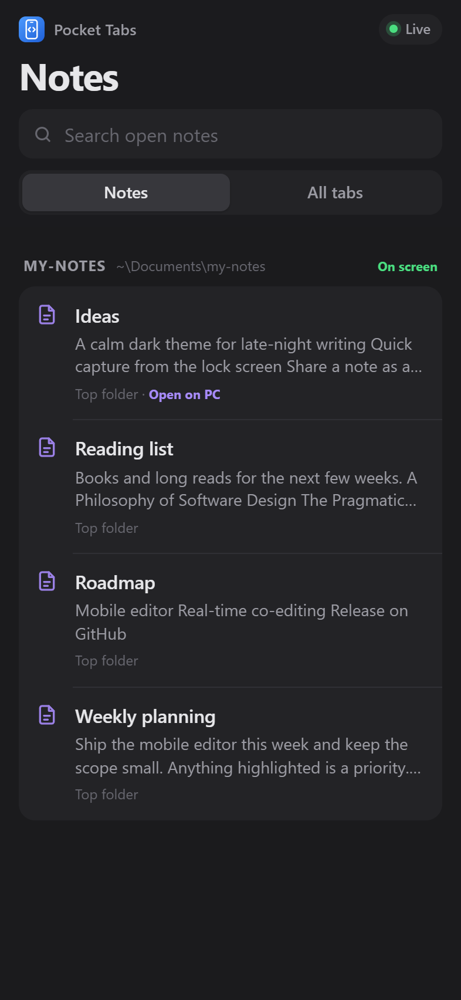
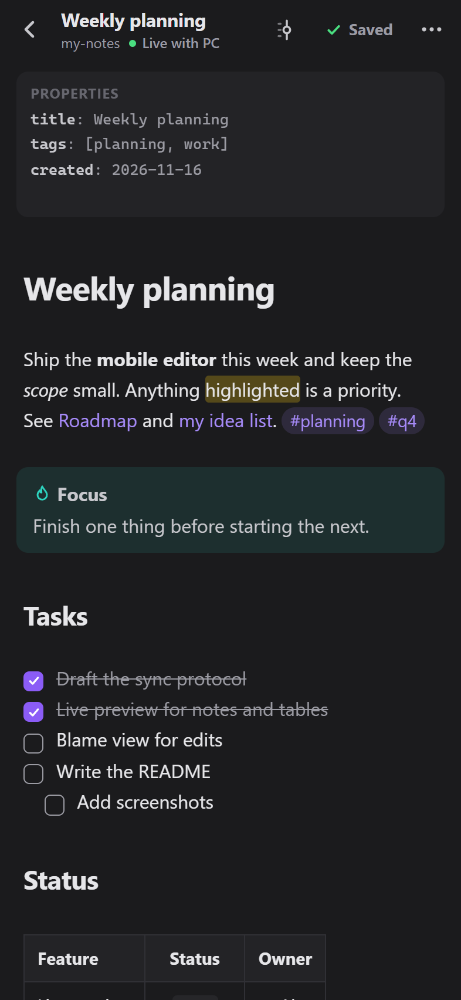
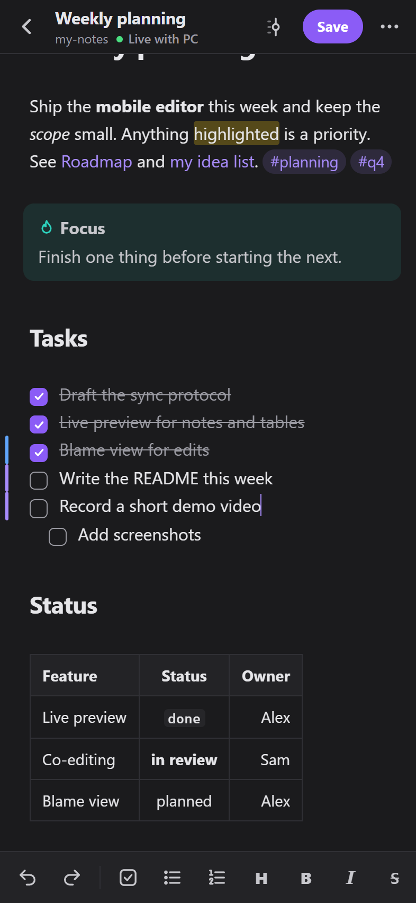
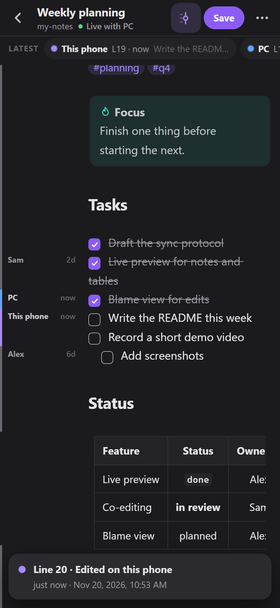
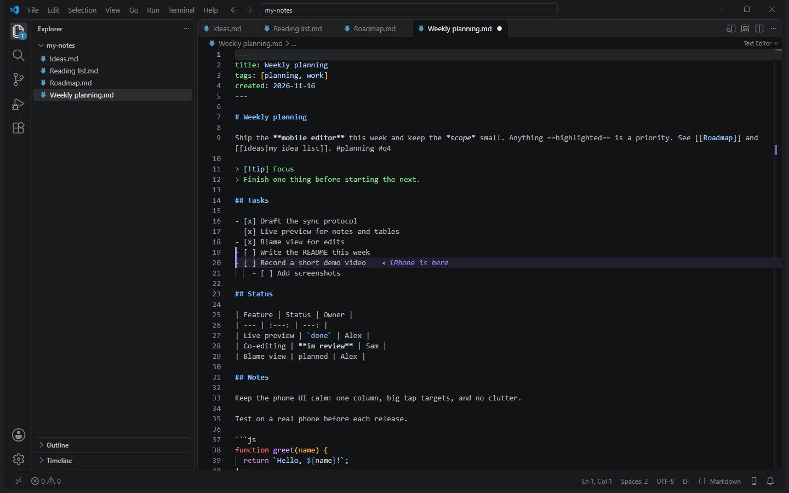
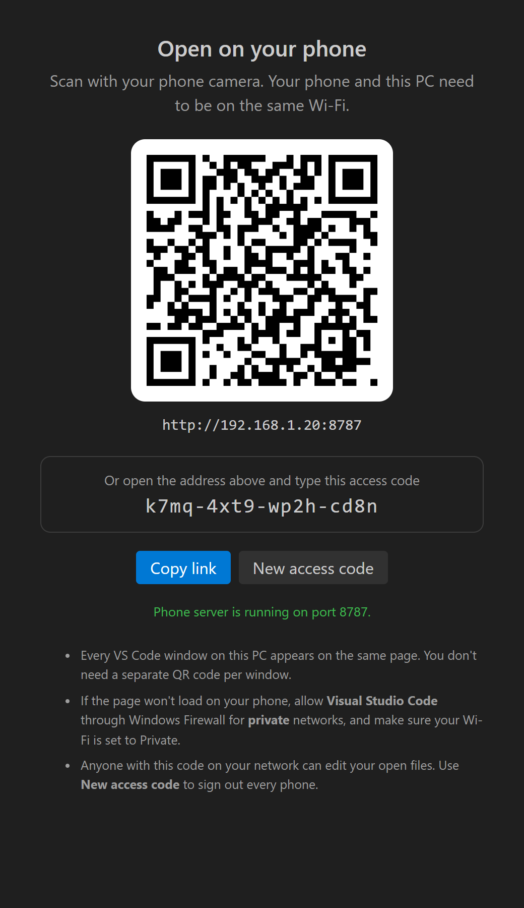

# Pocket Tabs

[](https://github.com/HokageZ/pocket-tabs/actions/workflows/release.yml)
[](https://github.com/HokageZ/pocket-tabs/releases/latest)

See the tabs that are open in **every VS Code window on your PC** and edit them from your phone, over your home or office Wi-Fi. Nothing goes through the internet. Notes look like Obsidian, you can type on the PC and the phone at the same time, and you can see who changed every line.

## Screenshots

### On the phone

| Your open notes | Live Preview | Editing | Who changed what |
| :---: | :---: | :---: | :---: |
|  |  |  |  |
| Every Markdown file open in any VS Code window | Obsidian-style rendering | Formatting bar; violet = this phone, blue = PC | Git blame plus this session's edits |

### On the PC



Lines edited on the phone get a violet bar in VS Code (hover over one for the device and time), and the phone's cursor is shown as **◂ iPhone is here**.



Click the phone icon in the status bar to get the QR code, then scan it to connect.

## Install

1. Download `pocket-tabs-<version>.vsix` from the [latest release](https://github.com/HokageZ/pocket-tabs/releases/latest).
2. Install it:
   ```
   code --install-extension pocket-tabs-<version>.vsix
   ```
   Or in VS Code: **Extensions** view → **⋯** → **Install from VSIX…**
3. Reload open VS Code windows (**Developer: Reload Window**).

## How to use it

1. Once installed, the extension starts on its own in every VS Code window.
2. Click the **phone icon** in the VS Code status bar (bottom right), or run **Pocket Tabs: Show Phone QR Code** from the Command Palette.
3. Scan the QR code with your phone camera. Your phone and PC must be on the same Wi-Fi.
4. Tap a note to open it. Edits go to VS Code as you type, and you can keep typing on the PC at the same time. Tap **Save** to write the file to disk.

Tip: on the phone, use *Add to Home Screen* so it opens like an app.

## What you get on the phone

**A notes-first home screen.** The **Notes** view lists every Markdown file open in any VS Code window, grouped by window, with a short preview of each note. **All tabs** shows every tab, code files included. Unsaved files have a yellow dot, and "Open on PC" marks the tab that is in front on the PC.

**Markdown that looks like Obsidian.** Notes open in **Live Preview**. Formatting is rendered, and the Markdown syntax appears only on the line you're editing. Supported:

- headings, **bold**, *italic*, ~~strike~~, ==highlight==, `inline code`
- `[[wikilinks]]` and `[[note|aliases]]`, `#tags`, links
- task lists with tappable checkboxes, bullet and numbered lists
- callouts (`> [!tip] Title`, `[!warning]`, `[!note]` …), blockquotes, dividers
- tables, fenced code blocks with syntax highlighting
- images: standard Markdown image links and Obsidian's `![[pic.png]]` embeds (looked up in the window's workspace)
- YAML frontmatter, shown as a Properties block

Switch between **Live Preview**, **Source** and **Reading** from the ⋯ menu. In Reading view, tapping a `[[wikilink]]` opens that note if it's open in VS Code.

**Editing made for a phone.** A formatting bar above the keyboard has undo/redo, checklist, lists, heading, bold, italic, strike, highlight, `[[link]]`, link, code, quote, code block, divider, and indent/outdent. Lists continue when you press Enter.

Code files open with syntax highlighting, line numbers and a symbol key row. Terminals, webviews, notebooks, image previews and settings pages are listed but stay on the PC.

## Editing on the PC and the phone at the same time

Type in the same file on the PC and on the phone at once, like a shared Google Doc. Every keystroke goes into VS Code's editor within a fraction of a second, and PC typing shows up on the phone just as fast. Edits made at the same moment are merged character by character, so there are no "which version do you want?" prompts, even on the same line. Phone edits go into VS Code's undo history, so **Ctrl+Z** on the PC undoes them.

- **The PC's cursor** shows on the phone as a small blue **PC** flag, so you can see where you are typing on the PC.
- **The phone's cursor** shows in VS Code: that line is tinted and labelled "◂ iPhone is here".
- **Save button.** The header always shows the file's state: **✓ Saved**, or a filled **Save** button when VS Code has changes that aren't on disk yet. That includes changes you typed on the PC. **Auto-save** in the ⋯ menu saves a moment after you stop typing instead. It's off by default, so a half-written PC edit is never saved behind your back.

## Who changed what

Pocket Tabs records who made every change, line by line, like `git blame`:

- **Edit markers.** A thin bar next to each line changed this session: violet for this phone, blue for the PC, pink for another phone. It's brighter for the last 2 minutes.
- **Blame view** (the branch button in the header). A gutter shows who last changed each block of lines and when: "This phone · now", "PC · 5m", "iPhone · 1h". Lines from before the session come from **`git blame`**, showing the commit author and age, or "Uncommitted" for lines not committed yet.
- **Latest** strip (in blame view). The most recent edits as chips, newest first. Tap one to jump to that line.
- Tap a gutter label for details: device, exact time, and for git lines the commit hash and message.
- **In VS Code**, lines edited from a phone get a violet bar on the left and marks on the scrollbar. Hover over one to see which phone edited it and when. Turn this off with `pocketTabs.highlightPhoneEdits`.

Attribution is kept while the file is open in VS Code. Older history comes from git.

## Settings

| Setting | Default | |
| --- | --- | --- |
| `pocketTabs.enabled` | `true` | Turn Pocket Tabs off in a window. |
| `pocketTabs.port` | `8787` | Port the phone connects to. |
| `pocketTabs.bindAddress` | `0.0.0.0` | Address to listen on. `127.0.0.1` turns off phone access. |
| `pocketTabs.highlightPhoneEdits` | `true` | Violet bars on lines edited from a phone, and the phone's cursor, inside VS Code. |

## Security

- The phone page asks for an access code. The QR code includes it, and after you scan it the phone stays signed in.
- **Pocket Tabs: New Access Code** signs out every phone.
- A phone can only read and edit files that are **currently open in a tab**. It can't browse your disk. Images in notes are served only if they are image files inside that window's workspace folders (or the note's own folder).
- Traffic is plain HTTP on your local network. Use it on networks you trust (home or office), not on public Wi-Fi.

## Troubleshooting

- **The phone can't load the page.** Windows Firewall is probably blocking it. The first time, Windows asks whether to allow *Visual Studio Code*. Allow it on **Private networks**, and make sure your Wi-Fi is set to *Private* in Windows Settings → Network. If you dismissed that prompt, open *Windows Security → Firewall → Allow an app through firewall* and tick **Private** for Visual Studio Code.
- **The wrong IP is in the QR code.** If the PC has several network adapters, the QR panel shows a button for each one. Pick the Wi-Fi or Ethernet address.
- **A warning icon next to the phone icon.** Something else is using port 8787. Change `pocketTabs.port`.
- **Logs.** Run **Pocket Tabs: Show Log**.

## How it works

Each VS Code window runs a small server that only accepts connections from the PC itself (`127.0.0.1`) and registers itself in `~/.vscode-pocket-tabs/<port>/instances/`. One window also takes the LAN port and serves the phone page. It forwards requests to the right window and pushes live updates to the phone (Server-Sent Events). When that window closes, another window takes over the port within a few seconds.

Co-editing uses operational transformation, the same scheme as `@codemirror/collab`. VS Code's document is the source of truth. Every change to it, typed on the PC or sent from a phone, is appended to a per-file log along with who made it. The phone sends CodeMirror change sets tagged with the log version they were made on. If the PC changed the file in the meantime, the phone receives the missing changes, rebases its own on top, and resends. The same log drives the line-by-line attribution, and `git blame --contents -` fills in the history from before the session.

## Development

The phone editor is CodeMirror 6 with a custom Live Preview layer (`web/`), bundled by esbuild into `media/editor.js`.

```
npm install
npm run build      # bundle web/ -> media/editor.js
npm test           # diff/merge tests, co-editing fuzz test (PC + two phones), blame tests
npm run package    # builds pocket-tabs-<version>.vsix (runs the build first)
code --install-extension pocket-tabs-<version>.vsix
```

### Releasing

Every push and pull request runs the tests and builds the `.vsix` (it's attached to the workflow run). To publish a release:

1. Bump `version` in `package.json` and commit.
2. Tag and push:
   ```
   git tag v1.2.0
   git push origin v1.2.0
   ```

The [Build and release](.github/workflows/release.yml) workflow checks that the tag matches `package.json`, runs the tests, packages the extension, and publishes a GitHub release with the `.vsix` attached.
